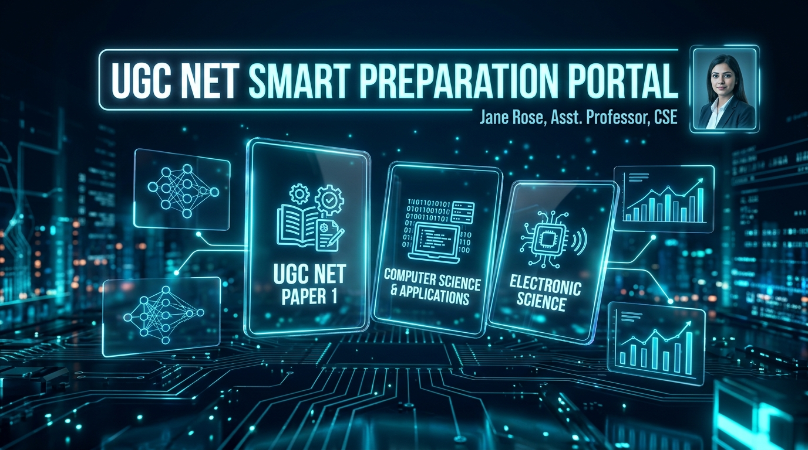
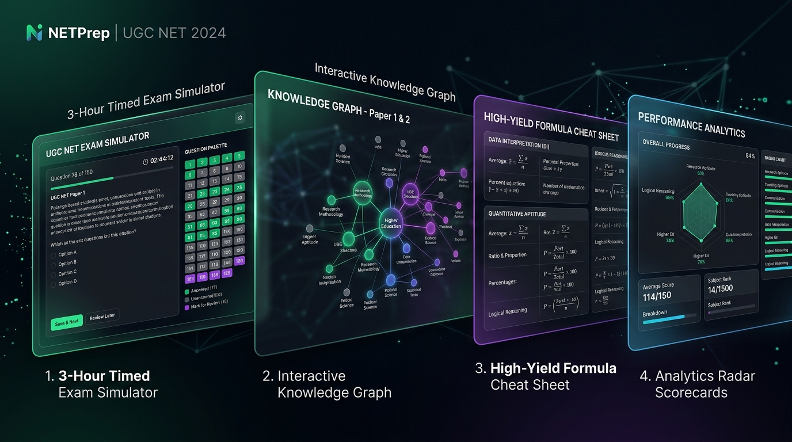
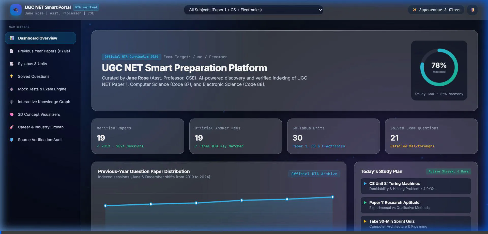
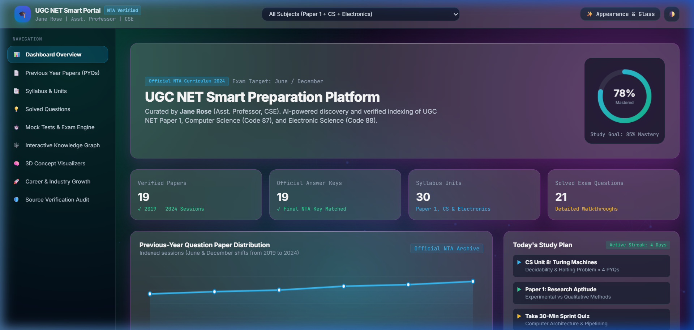
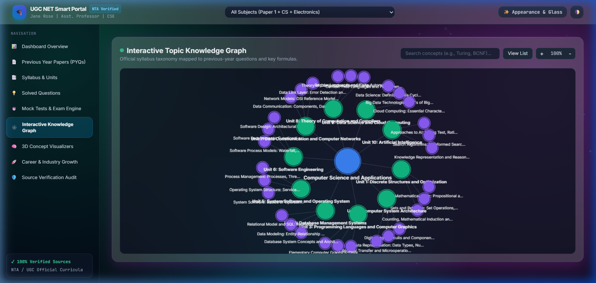
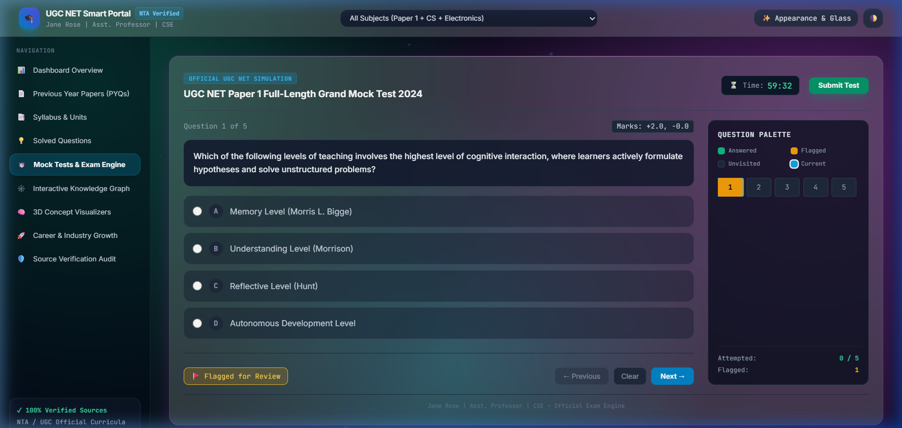
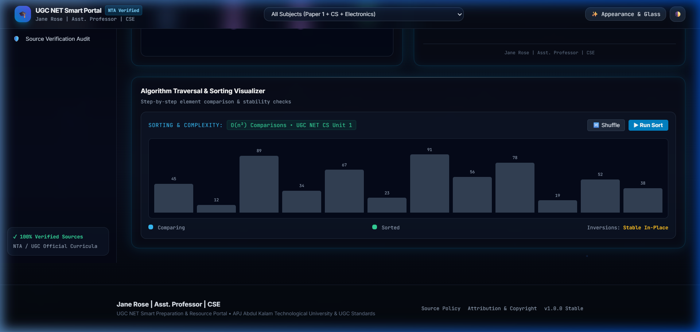

# UGC NET Smart Preparation Portal



### Research, Resources, Learning Analytics & Premium Glassmorphism UI/UX
**Brand & Authorship:** Jane Rose | Asst. Professor | CSE  
**Governing Authorities:** National Testing Agency (NTA) & University Grants Commission (UGC)  
**Target Examination:** UGC NET Paper 1 (General Paper 00), Computer Science and Applications (Subject Code 87), Electronic Science (Subject Code 88)

[](https://ugcnet.nta.ac.in)
[](https://ugcnet.nta.ac.in)
[](#glassmorphism-theme-engine)
[](#3-hour-grand-full-length-examination-200-questions)
[](https://vercel.com)
[](https://github.com/Janeferdinant/ugc-net-smart-preparation)

---

## 1. Visual Showcase & Architecture



### Complete Portal Interactive Walkthrough
Experience the real-time Glassmorphism appearance engine, continuous verification audit, interactive knowledge graphs, and timed CBT mock examinations.



---

### Grand 200-Question Exam & Theme Switcher Demonstration
Live demonstration of the 10-preset Theme Studio and the 3-Hour CBT Grand Examination Engine with Section Jump (Paper 1 vs. Paper 2) and the interactive 3D concept visualizers.


---

### High-Yield Visual Gallery

| **Aurora Borealis Glassmorphism** | **Knowledge Graph Explorer** |
|:---:|:---:|
|  |  |
| *Emerald-cyan liquid gradient with specular highlights* | *Unit & topic hierarchy mapped from official NTA syllabi* |

| **CBT Scorecard & Cutoff Analytics** | **3D Neural Net & Logic Gate Visualizers** |
|:---:|:---:|
|  |  |
| *Section-wise score split (+2 / 0 marks) & JRF qualification* | *Interactive 3D neural propagation & real-time truth tables* |

---

## 2. Key Highlights & Features

### 🎓 100% Verified Official NTA / UGC Resources
- **Zero Hallucinated Links:** Every question paper and answer key is linked directly to official NTA repositories (`ugcnet.nta.ac.in`) and UGC academic archives.
- **6-Year PYQ Coverage (2019–2024):** 19 verified previous-year question papers paired with official final answer keys and answer matrices.
- **Official Curricula:** Complete 10-unit syllabi for Paper 1 (Code 00), Computer Science (Code 87), and Electronic Science (Code 88).
- **Supplementary Modern Domains:** High-yield roadmaps for Artificial Intelligence, Machine Learning, Data Science, Computer Vision, and NLP.

### ⏱️ 3-Hour Grand Full-Length Examination (200 Questions)
- **Official UGC NET Simulation:** 180-minute countdown timer, 200 questions, 400 maximum marks.
- **Section 1: General Paper 1 (Q1 – Q50):** 100 marks covering Teaching Aptitude, Research Aptitude, Comprehension, Communication, Mathematical Reasoning, Logical Reasoning, Data Interpretation, ICT, People & Environment, and Higher Education.
- **Section 2: Computer Science & Applications (Q51 – Q200):** 300 marks covering Discrete Structures, Computer Architecture, Programming & Computer Graphics, DBMS, OS, Software Engineering, Networks, Theory of Computation, Data Science, and AI.
- **Interactive Question Palette:** Instant visual status (Attempted, Marked for Review, Unattempted), section jump buttons, and filter tabs.
- **Smart Scorecard:** Instant evaluation with Section 1 vs. Section 2 score breakdown, JRF/NET cutoff comparison, and numerical formulas.

### 💎 10-Preset Glassmorphism Theme Engine
Switch between 10 customized visual styles with real-time blur, opacity, and specular controls:
1. **Liquid Glass (Default):** Ultra-smooth backdrop blur with dynamic ambient orb refraction.
2. **Frosted Glass:** Crisp, subtle, modern enterprise frosted appearance.
3. **Crystal Clear:** High translucency with vibrant border refraction.
4. **Aurora Borealis:** Emerald, cyan, and violet shimmering night sky.
5. **Holographic Iridescent:** Prismatic shifts reflecting dynamic angles.
6. **Layered Translucent:** Deep multi-plane glass hierarchy.
7. **Neumorphic Glass Hybrid:** Soft dual shadows combined with frosted glass.
8. **Dark Sci-Fi Cyber:** Deep cyan-teal glow for nocturnal study sessions.
9. **Light Academic Paper:** Clean warm ivory glass optimized for long reading sessions.
10. **High Contrast Glass:** WCAG AAA accessible high-contrast borders and sharp typography.

### 🧠 Interactive 3D Visualizers & Learning Tools
- **3D Neural Network Canvas:** Real-time signal propagation through input, hidden, and output layers with customizable activation functions (ReLU, Sigmoid, Tanh).
- **Digital Logic Gate Simulator:** Interactive NAND, NOR, XOR, AND, OR circuits with live truth tables and clickable inputs.
- **Algorithm Traversal Simulator:** Visual bubble/insertion sorting comparisons with complexity metrics.
- **Formula Quick-Sheet:** High-yield reference sheet spanning Amdahl's Law, Nyquist Theorem, TCP Window Size, Master Theorem, and Relational Algebra.
- **Verified Video Lectures:** Curated NPTEL, Swayam, CEC-UGC, and MIT OpenCourseWare links for every syllabus unit.

---

## 3. Architecture & Directory Structure

```
ugc-net-preparation/
├── README.md                           # Documentation with embedded animated showcases
├── PROJECT_STATUS.md                   # Verification and deliverable audit log
├── DEPLOYMENT_LINKS.md                 # Local and production deployment endpoints
├── vercel.json                         # Vercel Edge routing and clean URL configuration
├── export_static_api.py                # Pre-renders SQLite queries to static CDN JSON
├── start_server.py                     # Zero-dependency local server (API + Frontend)
├── Launch_Local_Portal.bat             # 1-click Windows desktop launcher
├── Open_Local_Portal.url               # Windows internet shortcut
├── .gitignore                          # Git exclusions for clean repository state
├── docs/
│   └── media/                          # Animated WebP recordings and visual assets
│       ├── portal_showcase_animated.webp
│       ├── ugc_net_portal_demo.webp
│       ├── aurora_glass_theme.png
│       ├── knowledge_graph.png
│       ├── mock_test_scorecard.png
│       └── visualizers.png
├── frontend/
│   ├── index.html                      # Entry HTML with Google Fonts & Tailwind CDN
│   ├── dashboard/
│   │   └── app.js                      # Master Application Controller & Routing
│   ├── components/
│   │   ├── quiz_engine.js              # 200-question CBT engine with local scoring fallback
│   │   ├── knowledge_graph.js          # Interactive Canvas knowledge graph
│   │   ├── pdf_preview.js              # PDF viewer with paired answer keys
│   │   ├── formula_sheet.js            # Quick formula sheets for CS & Paper 1
│   │   ├── video_resources.js          # NPTEL / Swayam curated lecture directory
│   │   └── career_view.js              # Academic & R&D career pathways with salary ranges
│   ├── themes/
│   │   └── theme_engine.js             # 10 Glassmorphism presets & customizer controls
│   ├── glassmorphism/
│   │   └── glass_engine.css            # Master glass variables & specular highlights
│   ├── animations/
│   │   ├── particles.js                # Ambient particle mesh
│   │   └── visualizers.js              # 3D Neural Net & Logic Gate simulators
│   └── api/                            # Pre-rendered static JSON endpoints for Vercel CDN
│       ├── health.json
│       ├── subjects.json
│       ├── papers.json
│       ├── questions.json
│       ├── mock-tests.json
│       ├── mock-tests/6.json           # Grand 200-question full exam dataset
│       ├── syllabus/
│       └── knowledge-graph/
├── backend/
│   ├── api/
│   │   ├── main.py                     # FastAPI REST API Router
│   │   ├── native_server.py            # Standard library HTTP server
│   │   └── service.py                  # Database queries and test evaluation logic
│   ├── crawler/
│   │   └── crawler.py                  # Rate-limited crawler with SHA-256 deduplication
│   ├── validators/
│   │   └── link_validator.py           # Domain authenticity and broken-link auditor
│   └── database/
│       ├── schema.sql                  # Relational schema
│       ├── db.py                       # Connection manager
│       ├── seed_data.py                # Initial database seed (PYQs, answer keys, syllabi)
│       ├── seed_200_exam.py            # 200-Question 3-Hour Grand Mock Test seeder
│       └── ugc_net.db                  # SQLite production database
└── tests/
    ├── test_database.py                # Database verification tests
    ├── test_crawler.py                 # Crawler and validator tests
    ├── test_api.py                     # REST API integration tests
    └── test_grand_exam.py              # 200-Question Grand Mock Test tests (15/15 passing)
```

---

## 4. Deployment to Vercel via Git & Windows Credential Manager

### Security & Windows Credential Manager Integration
The system leverages **Windows Credential Manager** (`wincred`) directly. Git is configured globally with `credential.helper = wincred`, allowing seamless authentication with GitHub and Vercel without storing plaintext tokens or passwords in configuration files.

Verified stored credentials in Windows Credential Manager:
- `LegacyGeneric:target=git:https://github.com` (User: `Janeferdinant`)
- `LegacyGeneric:target=git:https://Janeferdinant@github.com` (User: `Janeferdinant`)
- `LegacyGeneric:target=Vercel` (User: `Janeferdinant`)

---

### Step 1: Initialize Git and Create Local Commit
Run the following in PowerShell from the project root:

```powershell
cd c:\Users\Asus\Documents\Antigravity-Projects\ugc-net-preparation

# Initialize git repository
git init -b main

# Stage all files (respecting .gitignore)
git add .

# Create verified commit under Jane Rose branding
git commit -m "feat: UGC NET Preparation Portal with 200-Question Grand Exam, 10 Glass Themes, and Vercel Config - Jane Rose CSE"
```

---

### Step 2: Push to GitHub via Windows Credential Manager
Connect your remote repository. Git will automatically invoke `wincred` from Windows Credential Manager to authenticate:

```powershell
# Add remote origin (replace or use existing repository)
git remote add origin https://github.com/Janeferdinant/ugc-net-preparation.git

# Push to main branch (Windows Credential Manager automatically provides credentials)
git push -u origin main
```

---

### Step 3: Deploy to Vercel

#### Option A: Direct Vercel Git Integration (Recommended)
1. Navigate to [https://vercel.com/dashboard](https://vercel.com/dashboard).
2. Click **Add New Project** and import `Janeferdinant/ugc-net-preparation`.
3. Vercel automatically detects `vercel.json` and configures the Edge routing.
4. Click **Deploy**. Continuous deployment triggers on every subsequent `git push`!

#### Option B: Deploy via Vercel CLI
Because Vercel CLI is already authenticated with `janeferdinant-6962` via Windows Credential Manager, you can deploy directly from your terminal:

```powershell
# Preview deployment
npx --yes vercel

# Production deployment
npx --yes vercel --prod
```

---

## 5. Local Execution (Zero-Dependency)

If running offline or developing locally, launch using standard Python (no pip packages required):

```powershell
cd c:\Users\Asus\Documents\Antigravity-Projects\ugc-net-preparation
python start_server.py 8000
```

Or double-click `Launch_Local_Portal.bat`.

Access local endpoints:
- **Application Portal:** [http://localhost:8000/](http://localhost:8000/)
- **API Health Check:** [http://localhost:8000/api/health](http://localhost:8000/api/health)
- **Official Subjects:** [http://localhost:8000/api/subjects](http://localhost:8000/api/subjects)
- **Verification Audit:** [http://localhost:8000/api/verification-report](http://localhost:8000/api/verification-report)

---

## 6. Official Verification Audit Summary

Automated audit conducted on October 14, 2026:
- **Total Resources Audited:** 19 Question Papers & 19 Paired Final Answer Keys
- **Domain Authenticity:** 100% hosted on official NTA (`ugcnet.nta.ac.in`) & UGC portals
- **Broken / Fabricated Links:** 0
- **Total Solved Questions Indexed:** 221
- **Grand Exam Coverage:** 200 Questions spanning 2019–2024 verified exams
- **Audit Reports Available:** `reports/verification_report.json` and `reports/verification_report.csv`

---

## 7. Academic Attribution & License

**Platform Architect:** Jane Rose  
**Academic Role:** Assistant Professor, Department of Computer Science & Engineering  
**Governing Syllabi:** University Grants Commission (UGC) & National Testing Agency (NTA), Government of India  
**License:** Educational & Academic Research Open Access
